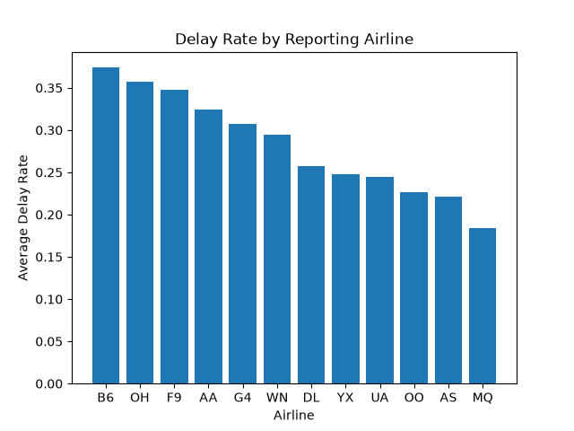
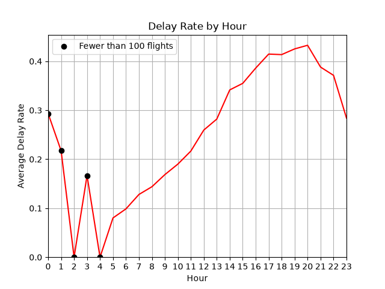

# Flight Delay Analytics Pipeline

A pipeline that turns raw US flight records into a queryable database, analyzes delay patterns, and (planned) predicts which flights will arrive late.

**Status:** Phase 1 complete (cleaning, DuckDB, SQL analysis, plots). Later phases are listed under Roadmap.

## Data

US Bureau of Transportation Statistics, Reporting Carrier On-Time Performance. Current results use a 50,000-flight random sample (fixed seed) of July 2026. A flight counts as **delayed** if it arrived more than 15 minutes late. The raw data is not included in this repo.

## What's done

- **Cleaning (pandas):** kept about 10 of 100+ columns; converted `FlightDate` to a datetime; built a 24-hour `dep_hour` from scheduled departure time, mapping the BTS value 2400 to hour 0; dropped cancelled and diverted flights (1,626 of 50,000, about 3.3%), since their arrival delay is null and would otherwise be counted as on time.
- **Validation:** my `delayed` flag came out at 27.4% versus 28.3% for BTS's own `ArrDel15` flag on the full month. The small gap is expected: one is a sample, and BTS flags 15 minutes or more while mine is strictly over 15.
- **Storage:** cleaned table saved to Parquet, loaded into DuckDB.
- **SQL:** delay rate by airline, by origin airport (airports with at least 100 flights), and by scheduled departure hour.
- **Leakage note:** `DepDelay` is kept for analysis but will not be a model input, because it is only known after the plane leaves.

## Findings (July 2026 sample)

**Airline:** B6 had the highest delay rate (37.4%, 1679) and MQ the lowest (18.4%, 2328), a gap of 19.0 percentage points.

**Airport:** Among airports with at least 100 flights, the 5 highest delay rates all belonged to airports with over 500 flights, and the 5 lowest to airports with under 200. This suggests larger airports run later, but I have not tested it beyond these extremes.

**Hour:** The delay rate generally rises from about 5 AM to 8 PM, then declines. Hours 0 to 4 have fewer than 100 flights, so their rates are too noisy to interpret and are marked on the chart.




## Project layout

```
Main/
  01_explore.ipynb   load and inspect the raw CSV
  02_clean.ipynb     cleaning, delayed flag, save to Parquet
  03_sql.ipynb       DuckDB load, SQL queries, plots
  plots/             saved figures
  data/              raw CSV, Parquet, DuckDB file (not tracked)
```

## Run it

1. Download the July 2026 file from BTS (Reporting Carrier On-Time Performance) and put the CSV in `data/`.
2. `pip install pandas pyarrow duckdb matplotlib`
3. Run the notebooks in order: 01, 02, 03.

## Roadmap

1. ~~Base: clean a sample, DuckDB, SQL, plots~~
2. Multi-month download with caching, star schema (fact and dimension tables)
3. Modeling: logistic regression, then gradient boosting with cross-validation; report AUC, precision at a fixed flag rate, and top delay drivers
4. Join NOAA weather by airport and hour, measure the improvement
5. Streamlit dashboard, tests, Docker

Items 2 to 5 are planned, not built.