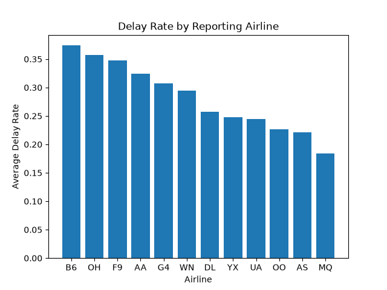
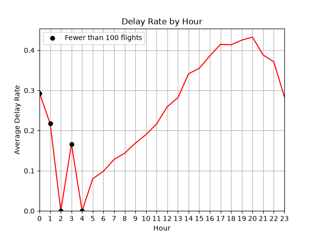

# Flight Delay Analytics Pipeline

A pipeline that turns raw US flight records into a queryable database, analyzes delay patterns, and (planned) predicts which flights will arrive late.

**Status:** Phase 1 (cleaning, DuckDB, SQL analysis, plots on a one-month sample) and Phase 2 (12-month download, star schema, full-data SQL analysis) are complete. Later phases are listed under Roadmap.

## Data

US Bureau of Transportation Statistics (BTS), Reporting Carrier On-Time Performance. A flight counts as **delayed** if it arrived more than 15 minutes late. The raw data is not included in this repo.

- **Phase 1:** a 50,000-flight random sample (fixed seed) of July 2026.
- **Phase 2:** all flights from 12 months, August 2025 to July 2026, with no sampling (7,043,858 flights).

## Phase 1: July 2026 sample

### What's done

- **Cleaning (pandas):** kept about 10 of 100+ columns; converted `FlightDate` to a datetime; built a 24-hour `dep_hour` from scheduled departure time, mapping the BTS value 2400 to hour 0; dropped cancelled and diverted flights (1,626 of 50,000, about 3.3%), since their arrival delay is null and would otherwise be counted as on time.
- **Validation:** my `delayed` flag came out at 27.4% versus 28.3% for BTS's own `ArrDel15` flag on the full month. The small gap is expected: one is a sample, and BTS flags 15 minutes or more while mine is strictly over 15.
- **Storage:** cleaned table saved to Parquet, loaded into DuckDB.
- **SQL:** delay rate by airline, by origin airport (airports with at least 100 flights), and by scheduled departure hour.
- **Leakage note:** `DepDelay` is kept for analysis but will not be a model input, because it is only known after the plane leaves.

### Findings (July 2026, 50k sample)

**Airline:** B6 had the highest delay rate (37.4%, 1679) and MQ the lowest (18.4%, 2328), a gap of 19.0 percentage points.

**Airport:** Among airports with at least 100 flights, the 5 highest delay rates all belonged to airports with over 500 flights, and the 5 lowest to airports with under 200. This suggests larger airports run later, but I have not tested it beyond these extremes.

**Hour:** The delay rate generally rises from about 5 AM to 8 PM, then declines. Hours 0 to 4 have fewer than 100 flights, so their rates are too noisy to interpret and are marked on the chart.




## Phase 2: Full 12 months, star schema

### Download (`download.py`)

- Downloads the BTS monthly zip for each month from August 2025 to July 2026, extracts the one CSV inside into `data/raw/`, and deletes the zip.
- Also downloads two BTS lookup tables: `L_UNIQUE_CARRIERS` (airline code to name) and `L_AIRPORT` (airport code to "City, ST: Airport Name"). These are converted from Windows-1252 to UTF-8 so DuckDB can read them.
- **Caching:** a file already in `data/raw/` is skipped, so re-running only downloads what is missing. Files are written as `.part` first and renamed only when complete, so a half-finished download is never treated as cached.
- A month that BTS has not published yet (404) or a failed download is reported and skipped, and listed in a summary at the end.

### Star schema (`04_build_schema.ipynb`)

Built in DuckDB (`data/flights.duckdb`) directly from the CSVs, so the full year never has to be loaded into pandas.

```
                 dim_date
                 (date)
                    |
                    | flight_date
                    |
dim_carrier ---- fact_flights ---- dim_airport
(carrier_code)   carrier_code      (airport_code)
                 origin_airport ------^
                 dest_airport   ------^
```

- **`fact_flights`**, grain = one row per flight. Keys: `flight_date`, `carrier_code`, `origin_airport`, `dest_airport`. Measures: `dep_hour`, `dep_delay`, `arr_delay`, `delayed`, `cancelled`, `diverted`, `distance`.
- **`dim_date`**, one row per calendar day: day of week, month, meteorological season, weekend flag, and US federal holiday flag (from pandas' `USFederalHolidayCalendar`, using the observed date when a holiday falls on a weekend).
- **`dim_carrier`**, one row per airline that appears in the flights, with its name from `L_UNIQUE_CARRIERS`.
- **`dim_airport`**, one row per airport that appears as an origin or destination, with city, state, and airport name parsed from `L_AIRPORT`. Both `origin_airport` and `dest_airport` reference this one table.

**Different from Phase 1:** cancelled and diverted flights are kept. Their `arr_delay` and `delayed` are NULL, and the `cancelled` and `diverted` columns (1 = yes, 0 = no) let each query decide how to treat them. The cleaning rules for `dep_hour` and `delayed` are otherwise the same as Phase 1.

**Sanity checks:**

1. Row counts for each table, printed for comparison with rough expectations.
2. Primary key uniqueness: each dimension key is unique and never NULL.
3. Orphan check: every `fact_flights` key (date, carrier, origin airport, destination airport) has a matching dimension row, so no flights silently drop out of joins.

Checks 2 and 3 use `assert`, so the notebook stops with an error if either fails.

### Findings (Aug 2025 to Jul 2026, full data)

From `05_sql_full.ipynb`. Delay rates are out of flights that arrived (cancelled and diverted flights have a NULL `delayed` value and are skipped). Cancellation rates are out of all flights. Overall delay rate: 21.7%.

**By airline:**

| Airline | Flights | Delay rate | Cancellation rate |
|---|---:|---:|---:|
| JetBlue Airways | 237,090 | 27.0% | 3.1% |
| Spirit Air Lines | 117,136 | 26.6% | 3.9% |
| Frontier Airlines Inc. | 209,405 | 26.2% | 1.9% |
| Allegiant Air | 126,499 | 25.3% | 0.7% |
| PSA Airlines Inc. | 242,215 | 25.3% | 4.3% |
| American Airlines Inc. | 987,645 | 24.7% | 2.2% |
| Southwest Airlines Co. | 1,389,951 | 22.7% | 0.9% |
| Republic Airline | 363,168 | 20.7% | 4.1% |
| SkyWest Airlines Inc. | 854,130 | 20.4% | 1.8% |
| United Air Lines Inc. | 825,693 | 20.1% | 1.0% |
| Alaska Airlines Inc. | 301,435 | 19.6% | 1.2% |
| Envoy Air | 317,726 | 18.5% | 2.2% |
| Delta Air Lines Inc. | 1,038,644 | 17.9% | 1.7% |
| Hawaiian Airlines Inc. | 33,121 | 17.2% | 0.7% |

As in the Phase 1 sample, JetBlue Airways has the highest delay rate (27.0%). PSA Airlines Inc. has the highest cancellation rate (4.3%), and JetBlue is in the top 4 for cancellation rate (3.1%).

**By season:**

| Season | Flights | Delay rate | Cancellation rate |
|---|---:|---:|---:|
| Summer | 1,841,925 | 24.9% | 1.8% |
| Winter | 1,641,344 | 21.9% | 2.8% |
| Spring | 1,821,756 | 21.3% | 1.6% |
| Fall | 1,738,833 | 18.6% | 1.2% |

Summer had the highest delay rate and Fall the lowest. Winter had the highest cancellation rate. The data covers one year, so each season appears once, and Summer combines Aug 2025 with Jun and Jul 2026.

**Holidays vs. non-holidays:**

| | Flights | Delay rate | Cancellation rate |
|---|---:|---:|---:|
| Holiday | 204,296 | 23.3% | 2.1% |
| Non-holiday | 6,839,562 | 21.6% | 1.8% |

These rates average all flights together, so busy days count more. To test the difference, I computed each day's delay rate and compared the 11 holidays with the 354 other days using Welch's t-test (α = 0.05):

- Mean daily delay rate: 22.4% on holidays, 21.5% on other days.
- t = 0.32, p = 0.75, so I fail to reject the null hypothesis. There is not sufficient evidence that holiday delay rates differ from regular days.
- **Caveats:** there are only 11 holidays, and they are spread unevenly across seasons. This result means no difference was detected, not that holidays have no effect on delays.
- `is_holiday` marks only the holiday itself, not nearby travel days. For example, 2025-11-30 (the Sunday after Thanksgiving) was 45.9% delayed but counts as a regular day.

**Top routes** (routes with at least 365 flights, highest delay rate first):

| Route | Flights | Delay rate | Cancellation rate |
|---|---:|---:|---:|
| Chicago (MDW) to San Francisco (SFO) | 485 | 50.6% | 1.2% |
| Knoxville (TYS) to Fort Lauderdale (FLL) | 481 | 44.6% | 0.8% |
| Dallas/Fort Worth (DFW) to Harrisburg (MDT) | 365 | 42.7% | 3.0% |
| Chicago (ORD) to Eagle (EGE) | 413 | 41.6% | 3.6% |
| Philadelphia (PHL) to Washington (DCA) | 789 | 40.4% | 4.3% |
| Dallas (DAL) to Charlotte (CLT) | 377 | 40.3% | 1.1% |
| Fort Lauderdale (FLL) to Asheville (AVL) | 659 | 40.1% | 1.1% |
| Dallas/Fort Worth (DFW) to Buffalo (BUF) | 578 | 39.9% | 2.9% |
| San Luis Obispo (SBP) to San Francisco (SFO) | 1,145 | 39.3% | 1.2% |
| Arcata/Eureka (ACV) to San Francisco (SFO) | 1,292 | 39.0% | 2.9% |

MDW to SFO had the highest delay rate (50.6%), more than double the overall rate of 21.7%. 3 of the top 10 routes end at SFO, and both Chicago airports (MDW and ORD) appear. These are patterns in the data, not evidence of what causes the delays.

**Index benchmark:** I timed two queries 10 times each, before and after adding an index on `fact_flights(origin_airport, dest_airport)`, and compared the medians.

| Query | Before index (s) | After index (s) |
|---|---:|---:|
| Routes (all 7M rows, grouped) | 0.168 | 0.160 |
| Lookup (MDW to SFO only) | 0.023 | 0.023 |

The index gave no meaningful speedup for either query, so it was dropped. The routes query reads every row, so an index has nothing to skip. Even the lookup query, the case indexes are designed for, didn't improve. The likely reason is that DuckDB already skips irrelevant chunks of data without an index, but this was not tested (for example, with `EXPLAIN`).

## Project layout

```
Main/
  01_explore.ipynb        Phase 1: load and inspect the raw July 2026 CSV
  02_clean.ipynb          Phase 1: cleaning, delayed flag, save to Parquet
  03_sql.ipynb            Phase 1: DuckDB load, SQL queries, plots
  download.py             Phase 2: download 12 months of BTS data and lookup tables, with caching
  04_build_schema.ipynb   Phase 2: build the star schema in DuckDB, sanity checks
  05_sql_full.ipynb       Phase 2: full-data SQL analysis, holiday t-test, index benchmark
  plots/                  saved figures
  data/                   July 2026 CSV, Parquet, DuckDB file (not tracked)
    raw/                  monthly CSVs and lookup tables from download.py (not tracked)
```

## Run it

1. `pip install pandas pyarrow duckdb matplotlib scipy numpy`
2. **Phase 1:** download the July 2026 file from BTS (Reporting Carrier On-Time Performance), put the CSV in `data/`, then run notebooks 01, 02, 03 in order.
3. **Phase 2:**
   1. `python download.py` (downloads into `data/raw/`; re-running skips files already there)
   2. Run `04_build_schema.ipynb` to build the star schema.
   3. Run `05_sql_full.ipynb`.

DuckDB allows only one program to write to `data/flights.duckdb` at a time, so close or restart any other notebook kernel connected to it before running 04.

## Roadmap

1. ~~Base: clean a sample, DuckDB, SQL, plots~~
2. ~~Multi-month download with caching, star schema (fact and dimension tables)~~
3. Modeling: logistic regression, then gradient boosting with cross-validation; report AUC, precision at a fixed flag rate, and top delay drivers
4. Join NOAA weather by airport and hour, measure the improvement
5. Streamlit dashboard, tests, Docker

Phases 1 and 2 are done. Items 3 to 5 are planned, not built.
